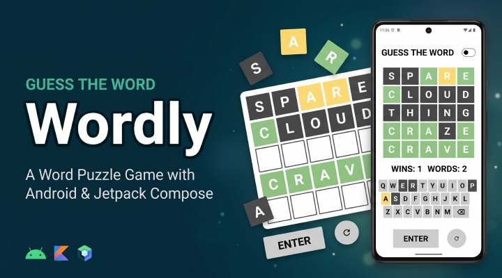
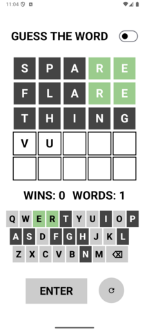
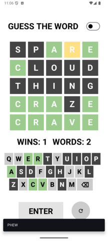
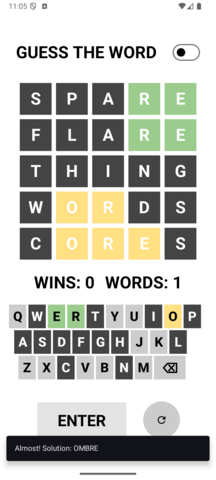
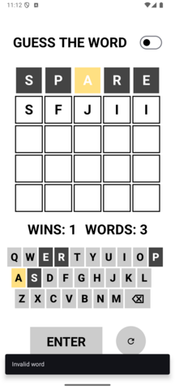
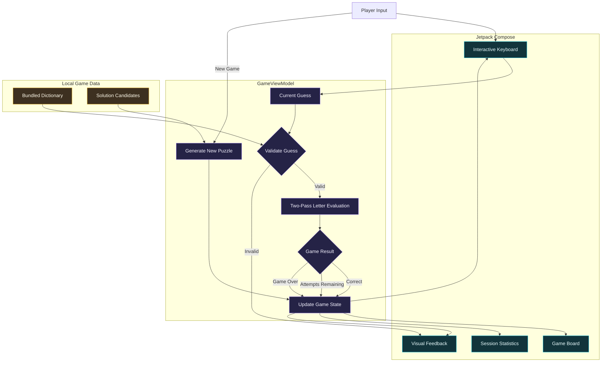

<div align="center">

  

  <h1>Wordly</h1>

  <p>
    <strong>Five letters, endless curiosity.</strong>
  </p>

  <p>
    A native Android word puzzle game combining logical thinking,
    interactive gameplay, and reactive interfaces built with
    Kotlin and Jetpack Compose.
  </p>

  <p>
    Android · Kotlin · Jetpack Compose · Material 3
  </p>

  <p>
    <a href="#about">About</a> ·
    <a href="#app-preview">Preview</a> ·
    <a href="#how-to-play">How to Play</a> ·
    <a href="#features">Features</a> ·
    <a href="#under-the-hood">Under the Hood</a> ·
    <a href="#getting-started">Getting Started</a>
  </p>

  

  <br />

  <sub>
    Early Works · Native Android Development · Interactive Games
  </sub>

</div>

## About

Wordly is a small Android word puzzle game built around
a simple challenge: discover a hidden five-letter word
in five attempts.

Each guess provides visual clues that help narrow down
the possibilities, turning a straightforward concept
into an engaging exercise in vocabulary, deduction,
and pattern recognition.

The application combines a minimal interface, a custom
on-screen keyboard, interactive color feedback, and
a lightweight game engine that runs entirely on the device.

Part of my early explorations in Android development,
Wordly reflects my interest in building playful experiences
while exploring game logic, reactive state management,
and native user interfaces with Jetpack Compose.

## App Preview

<div align="center">

  
  
  
  

  <p>
    <sub>
      Interactive gameplay · Successful guess · Game over · Word validation
    </sub>
  </p>

</div>

A deliberately simple interface keeps the focus on
the puzzle itself, with immediate visual feedback
after every submitted word.

## How to Play

The objective is to discover the hidden five-letter word
using the available attempts.

1. Enter a five-letter word using the on-screen keyboard.
2. Submit the guess by pressing Enter.
3. Observe the color of each evaluated letter.
4. Use the available clues to construct your next guess.
5. Discover the hidden word before running out of attempts.

### Understanding the Clues

| Color | Meaning |
| :---: | :--- |
| 🟩 Green | The letter is correct and in the correct position. |
| 🟨 Yellow | The letter exists in the hidden word but belongs to another position. |
| ⬛ Gray | No remaining occurrence of the letter matches the hidden word. |
| ⬜ Empty | A letter has not yet been evaluated. |

The on-screen keyboard also updates its colors
according to previously submitted guesses.

### Example

Suppose the hidden word is `PLANT` and the
submitted guess is `PARTY`.

| P | A | R | T | Y |
| :---: | :---: | :---: | :---: | :---: |
| 🟩 | 🟨 | ⬛ | 🟨 | ⬛ |

The player now knows that `P` occupies the correct
position, while `A` and `T` appear elsewhere in
the hidden word.

Invalid or incomplete words do not consume
an available attempt.

A new puzzle can be generated at any time
using the refresh button.

## Features

| Feature | Description |
| :--- | :--- |
| **Interactive Word Puzzle** | Discover a five-letter word within five attempts. |
| **Dynamic Game Board** | A reactive 5 × 5 grid displaying guesses and letter evaluations. |
| **Random Word Selection** | Generate new puzzles from a predefined collection of words. |
| **Local Dictionary** | Validate submitted guesses against a bundled vocabulary. |
| **Intelligent Letter Matching** | Two-pass evaluation that accounts for repeated characters. |
| **Custom Keyboard** | A dedicated QWERTY keyboard with contextual color feedback. |
| **Input Validation** | Reject incomplete and unrecognized words without consuming attempts. |
| **Session Statistics** | Track successful games and generated puzzles. |
| **Dark Mode** | Switch between light and dark interface appearances. |
| **Instant Replay** | Start a new puzzle without restarting the application. |
| **Offline Gameplay** | Play entirely on the device without network services or external APIs. |

## Under the Hood

Behind its minimal interface, Wordly explores the
implementation of a small interactive game using
native Android components and reactive state.

The application separates gameplay logic, interface
rendering, vocabulary data, and visual configuration
through a lightweight ViewModel-based architecture.

### Game Configuration

| Property | Configuration |
| :--- | :--- |
| Word length | 5 letters |
| Maximum attempts | 5 |
| Board dimensions | 5 × 5 |
| Dictionary entries | 5,757 |
| Solution candidates | 90 |
| Input | Custom QWERTY keyboard |
| Game state | Compose State |
| Word selection | Random |
| Network requirements | None |

### Gameplay Architecture



The ViewModel coordinates game operations and
exposes observable state to the Compose interface.

This allows the board, keyboard, counters, and
visual feedback to respond to gameplay changes
without manually updating individual Android views.

### Letter Evaluation Algorithm

The core game mechanic uses a two-pass evaluation
algorithm to determine the status of each letter.

The first pass identifies exact positional matches.

The second pass evaluates the remaining letters
against the unmatched characters of the hidden word.

```text
Input:
    guess    = submitted word
    solution = hidden word

Pass 1:
    Identify letters in the correct position.
    Mark them as green.
    Consume their occurrences in the solution.

Pass 2:
    Evaluate the remaining letters.

    If an unmatched occurrence exists:
        Mark the letter as yellow.
        Consume that occurrence.
    Otherwise:
        Mark the letter as gray.

Output:
    Color evaluation for each letter.
```

Consuming matched occurrences prevents duplicate
letters from receiving more matches than are
actually present in the hidden word.

The implementation is located in:

[`GameViewModel.kt`](./app/src/main/java/com/example/wordguessingapp/viewmodel/GameViewModel.kt)

### Word Validation

The application maintains two independent
sources of vocabulary.

| Source | Responsibility |
| :--- | :--- |
| `words.txt` | Local dictionary used to validate submitted guesses. |
| `WordList.kt` | Predefined collection of possible solutions. |

The dictionary is bundled as an Android raw resource
and loaded directly into memory.

Puzzle generation and word validation therefore
operate without requiring network access.

### Reactive Game State

The `GameViewModel` manages the main properties
of the game:

- Current input and hidden solution.
- Submitted guesses and active board row.
- Letter and keyboard colors.
- Successful and failed game states.
- Session statistics.
- Input validation feedback.
- Light and dark appearance.

The implementation uses `mutableStateOf`,
`mutableIntStateOf`, and observable Compose lists
to coordinate interface updates.

Game statistics and appearance preferences are
maintained in memory rather than persistent storage.

## Technology Stack

| Technology | Responsibility |
| :--- | :--- |
| **Kotlin** | Native application and gameplay logic. |
| **Jetpack Compose** | Declarative interface and interactive components. |
| **Material 3** | Buttons, switches, typography, and UI elements. |
| **Android ViewModel** | Game state and application lifecycle management. |
| **Compose State** | Reactive interface updates. |
| **Kotlin Coroutines** | Asynchronous snackbar feedback. |
| **Android Resources** | Local vocabulary and graphical resources. |
| **Gradle** | Build and dependency management. |

### Platform Configuration

| Property | Configuration |
| :--- | :--- |
| Platform | Native Android |
| Minimum Android Version | Android 5.1 — API 22 |
| Compile SDK | 34 |
| Target SDK | 34 |
| Kotlin | 1.9.0 |
| Compose Compiler | 1.5.1 |
| Compose BOM | 2024.04.01 |
| Android Gradle Plugin | 8.5.1 |
| Gradle | 8.7 |
| Development JDK | 17 |
| JVM Target | 1.8 |
| Application Version | 1.0 |

## Getting Started

### Requirements

- Android Studio.
- JDK 17.
- Android SDK Platform 34.
- Android device or emulator running API 22 or newer.
- Git.

### Clone the Repository

```bash
git clone https://github.com/4beru/wordly-word-guessing.git

cd wordly-word-guessing
```

### Run with Android Studio

1. Open the repository in Android Studio.
2. Configure JDK 17 and Android SDK 34.
3. Synchronize the Gradle project.
4. Select the `app` module.
5. Run the application on an Android device or emulator.

No API keys, backend configuration, or external
data services are required.

### Build from the Terminal

On Linux or macOS:

```bash
./gradlew :app:assembleDebug
```

On Windows:

```powershell
.\gradlew.bat :app:assembleDebug
```

The generated APK is available at:

```text
app/build/outputs/apk/debug/app-debug.apk
```

### Install on a Physical Device

Connect an Android device with USB debugging enabled.

```bash
adb devices -l
```

Install the application:

```bash
adb install -r app/build/outputs/apk/debug/app-debug.apk
```

Launch Wordly from the device or through ADB:

```bash
adb shell am start -n com.example.wordguessingapp/.MainActivity
```

---

<div align="center">

  <h3>Every word is a new possibility.</h3>

  <p>
    Part of my <strong>Early Works</strong> — a collection
    of experiments, first ideas, and creative projects
    that shaped my journey as a software developer.
  </p>

  <p>
    <sub>Curated by Abel Ortega.</sub>
  </p>

  <a href="https://github.com/4beru">GitHub</a> ·
  <a href="https://www.aberu.site">Portfolio</a>

</div>
